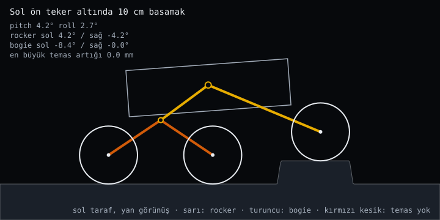
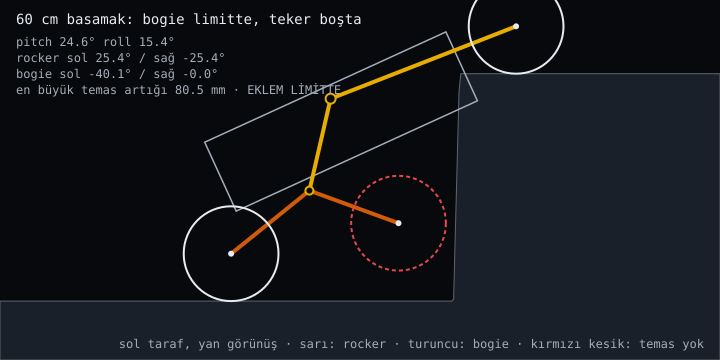

# Süspansiyon Kinematiği

Kod: `src/scene/rover/kinematics.ts` · Testler: `tests/unit/kinematics.test.ts` · Şekiller: `npm run plots` → `docs/kinematik/*.svg`

## 1. Çerçeveler ve işaretler
- **Zemin (ENU):** x doğu, y kuzey, z yukarı; orijin arazi merkezi. Arazi `Heightfield` (bilinear).
- **Gövde:** x ileri, y sol, z yukarı; orijin gövde merkezi.
- **İşaretler:** pozitif **pitch** burnu yukarı, pozitif **roll** sol tarafı yukarı kaldırır; rocker ve bogie açıları gövde x-z düzleminde, pozitif açı +x'i +z'ye çevirir (ön tarafı kaldırır). ROS'tan farklı olarak pitch işareti HUD okunurluğu için seçildi; dönüşümler yalnız `src/lib/frames.ts` içinde.
- **three.js:** `enuToThree(x, y, z) = (x, z, −y)`.

## 2. Mekanizma

Her tarafta bir **rocker**: gövdeye pivot `P` ile bağlı; ön tekerlek `F` ve bogie pivotu `B` rocker üzerinde. **Bogie**: `B` etrafında serbest döner, orta `M` ve arka `R` tekerlekleri taşır. İki rocker gövdenin içindeki **konik dişli diferansiyel** ile bağlıdır: rocker açıları gövdeye göre eşit ve ters (**α_sol = −α_sağ**), gövde iki tarafın ortalamasında kalır. 4 tekerlekli SummerTech'te bogie yoktur; her rocker iki tekerlek taşır.

Ölçüler (2027): `rover_params.yaml` → `src/content/rover2027.generated.json` (tekerlek r = 0.125 m; rocker ön kolu 0.45 m; bogie pivotu x = −0.225, z = −0.12 m; bogie yarı boyu 0.225 m; tekerlek z = −0.275 m; iz 0.68 m; limitler rocker ±0.52, bogie ±0.70 rad). SummerTech: fotoğraflardan oransal tahmin (`geometry.ts`).

## 3. Temas modeli
Bir tekerleğin merkezi, tekerlek profili (yan görünüşte yarıçap r'lik çember) hiçbir noktada araziye girmeyecek en düşük yüksekliktedir:

  z_destek(x, y) = max_{a ∈ [−60°, +60°]} [ h(x + r·sin a·cos ψ, y + r·sin a·sin ψ) + r·cos a ]   (9 örnek, 15° aralık)

Bu, keskin basamaklarda tekerleğin kenara "binmesini" doğru verir. Sınır: profil yalnız ilerleme yönünde örneklenir (yanal eğimde tekerlek genişliği yok sayılır).

## 4. Çözüm
**Bilinmeyenler** (6 tekerlek): gövde yüksekliği z, pitch θ, roll φ, rocker açısı α (sol = +α, sağ = −α), bogie açıları β_L, β_R. **Denklemler:** 6 tekerlek için `z_merkez(parametreler) − z_destek(x_merkez, y_merkez) = 0`. Tekerlek merkezleri **ileri kinematikle** hesaplanır (gövde dönüşü roll'ü de içerir); bu yüzden çizilen model ile temas birebir tutarlıdır. (İlk düşünülen "her tarafı ayrı yan görünüşte çöz" yöntemi roll'de tekerlek yanal ofseti yüzünden 10°'de ~1,5 cm hata bırakıyordu; kullanılmadı.)

**Yöntem:** düzlem uydurmasıyla (veya rota boyunca bir önceki pozdan) başlangıç → Gauss–Newton, sayısal Jacobian, normal denklemler `(JᵀJ + λI)Δ = −Jᵀr`, güven bölgesi (adım ≤ 0.15 m / 0.15 rad), Jacobian her 3 adımda bir (rotada pozlar arasında da en fazla 6 pozda bir) yeniden hesaplanır, artık < 0.2 mm'de durur. Yineleme kuralları sabit olduğundan sonuç **deterministiktir**: aynı girdi → bit düzeyinde aynı çıktı; scroll geri sarılınca aynı poz.

**Eklem limitleri:** limit aşılırsa açı sınırda sabitlenir ve bir tekerlek havaya kalkmak zorundadır. Hangisi? **Aktif küme:** her tekerlek sırayla temas dışı sayılır, kalan sistem çözülür; gömülme olmayan ve limitlere uyan en küçük artıklı çözüm seçilir. Havadaki tekerlek `inContact = false` (HUD: "TEKER BOŞTA").

## 5. Doğrulama (testler)
| Senaryo | Beklenen (geometriden) | Sonuç |
|---|---|---|
| Düz zemin | tüm açılar 0, gövde z = r − z_teker = 0.40 m | ✓ (< 1e−6) |
| 15° yokuş (3 farklı yönde) | pitch = 15°, rocker ≈ bogie ≈ 0 | ✓ (±0.1°) |
| 10° yan eğim | roll = 10° | ✓ (±0.1°) |
| Sol ön teker altında 10 cm | 6 temas, α_sol = −α_sağ, pitch > 0, roll > 0 | ✓ |
| İki ön teker altında simetrik tümsek | diferansiyel kilitli: α = 0, roll = 0, eğimi gövde alır | ✓ |
| 45 cm basamak | limit içinde aşılır (Ø25 cm tekerin 1,8 katı) | ✓ |
| 60 cm basamak | eklem limitte, bir teker havada, gömülme yok | ✓ |
| 80 cm basamak | ıraksama yok (|açı| < 45°), gömülme yok | ✓ |
| 300 rastgele poz, engebeli arazi | artık < 3 mm | ✓ |
| 4 tekerlek (SummerTech): düz, basamak, 12° yokuş | eşdeğer beklentiler | ✓ |

**Performans** (Node, 2048 poz, 45 m engebeli rota): 1358 ms (ilk sürüm) → 146 ms (sıcak başlangıç) → **83 ms** (pozlar arası Jacobian), en kötü artık 0.18 mm. Hesap bölge yüklenirken bir kez **Web Worker**'da yapılır (`src/workers/routeSolver.worker.ts`); ana iş parçacığı etkilenmez. Prompttaki 50 ms hedefi, tekerlek profili örneklemesinden (temas doğruluğundan) ödün vermemek için zorlanmadı.

## 6. Bilinen sınırlar
- **Gövde–arazi çarpışması hesaplanmaz.** 60 cm şeklinde gövde köşesi basamağın içine girer; gerçekte rover bu basamağı çıkamaz. Rota planlayıcı (B11) engelleri 45 cm'nin altında tutar.
- Tekerlek profili yalnız ilerleme yönünde örneklenir; yanal eğimde tekerlek genişliği yok sayılır.
- Kayma, tekerlek gömülmesi (kum) ve dinamik etkiler yoktur: bu sinematik modun bilinçli tercihidir; fizik "Sen Sür" modunda (B20, Rapier).
- SummerTech geometrisi fotoğraftan tahmindir (Fusion dosyası gelirse güncellenecek).
