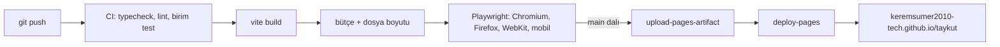

# Mimari

Bu belge sitenin teknik yapısını anlatır ve her bölümle birlikte büyür.

## Derleme ve yayın

- Tek iş akışı (`.github/workflows/ci.yml`): `deploy` işi `check` işine bağlıdır, bu yüzden kırmızı test yayına çıkamaz.
- Vite `base: '/taykut/'`; tüm varlık yolları bu önekle çözülür.

## Klasörler (şimdilik)
- `src/`: uygulama kodu (`@/` takma adı)
- `tests/unit/` (Vitest, jsdom), `tests/e2e/` (Playwright)
- `tools/`: derleme sonrası denetimler ve varlık hattı betikleri
- `prompts/`: bölüm promptları; `PROMPT_TAYKUT_SITE.md`: anayasa

_(Sahne yaşam döngüsü, store ve zaman çizelgesi bağları ilgili bölümlerde eklenecek.)_
